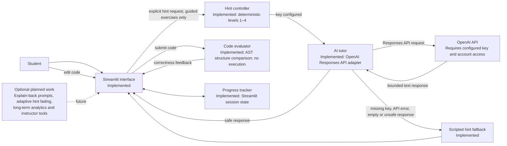

# SocraticCode architecture

The diagram distinguishes the implemented Phase 1–3 prototype from optional future work.

## Implemented boundaries

- The hint controller advances exactly one level per request and refuses hints for the Solo Check.
- The AI tutor receives the exercise objective, current student code, hint level and earlier hints. It does not receive the reference solution.
- The OpenAI client has a 20-second timeout, automatic retries disabled, a conservative output-token cap and response storage disabled. A model call occurs only after an explicit hint-button request.
- Hints are cached per exercise/level for the current session. API errors or a detected full-solution response produce a visible scripted fallback.
- API keys are read from `OPENAI_API_KEY` in the environment or Streamlit secrets. Local `.env` and `.streamlit/secrets.toml` files are ignored by Git.
- The evaluator parses and compares syntax trees and never executes untrusted student code.
- The Solo Check has no tutor entry point or hint widget.

## Known limitations and planned components

Prompt instructions and output checks reduce, but cannot eliminate, solution leakage. The structural evaluator may reject a logically correct implementation with different syntax. Progress is not persisted between sessions. Optional explain-back prompts, adaptive assistance fading, long-term performance analytics and instructor dashboards are not implemented.
